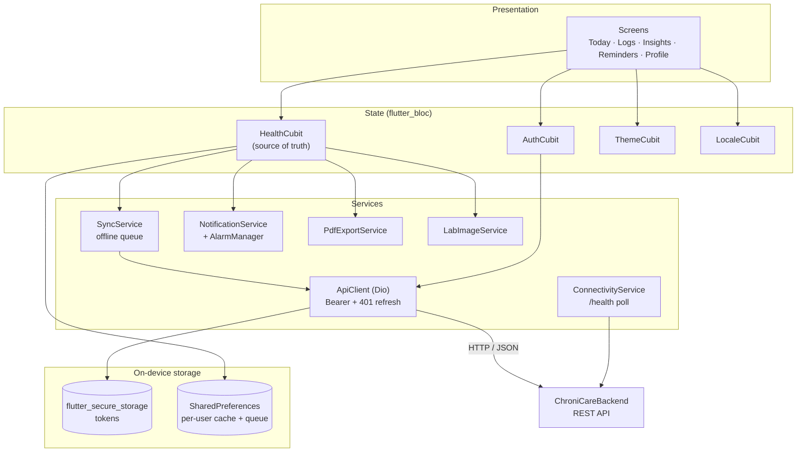
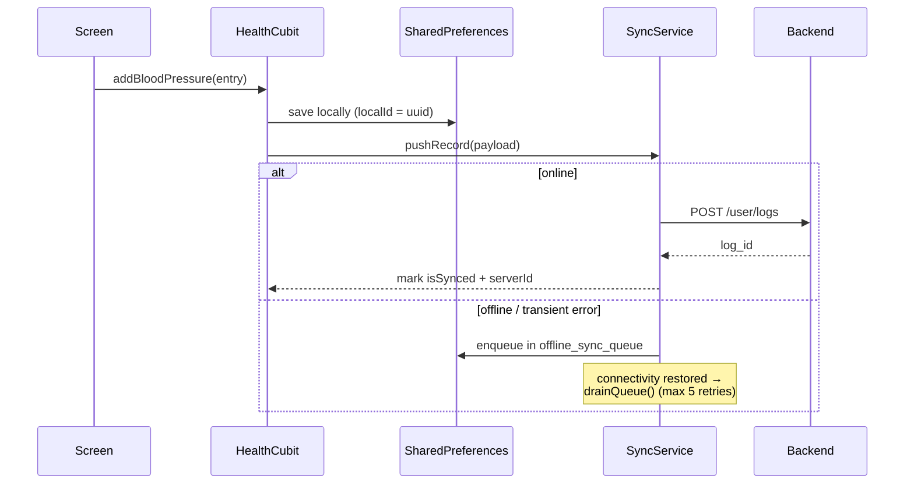

# ChroniCare (Flutter App)

The mobile client for **ChroniCare**, an app that helps people with chronic conditions (diabetes, hypertension, asthma) track their health, manage medication reminders, scan lab reports, and export clinical summaries. It is **offline-first**: everything works without a connection and syncs to the backend when one is available.

The API it talks to lives in [ChroniCareBackend](https://github.com/userman105/ChroniCareBackend).

---

## Table of contents

- [Features](#features)
- [System architecture](#system-architecture)
- [Tech stack](#tech-stack)
- [Project structure](#project-structure)
- [Getting started](#getting-started)
- [Configuration](#configuration)
- [Guest mode](#guest-mode)
- [How offline sync works](#how-offline-sync-works)
- [Backend integration](#backend-integration)
- [Known limitations & roadmap](#known-limitations--roadmap)

---

## Features

- **Onboarding and condition selection**: choose Diabetes, Hypertension or Asthma and personalize the daily schedule.
- **Health logs**: blood pressure, glucose, weight (with BMI), medications, food, symptoms, lab tests and doctor appointments, each with list, detail and history screens.
- **Insights**: charts of trends over time (`fl_chart`).
- **Reminders and alarms**: scheduled local notifications plus a full-screen alarm screen for medication and measurement reminders. They are re-scheduled automatically after a reboot via `AndroidAlarmManager`.
- **Lab report scanning**: pick or capture a photo, auto-crop and enhance it on-device, upload it, and get OCR text back as notes.
- **PDF export**: generate a shareable health report (patient details, summaries, BP, glucose, weight, medications, food) and open or print it.
- **Medication search**: bundled bilingual (Arabic / English) medication list in `assets/data/medications.csv`.
- **Bilingual UI**: English and Arabic with automatic RTL layout.
- **Light and dark themes**.
- **Accounts**: sign-up with email OTP verification, login, forgot/reset password, secure token storage, and automatic token refresh.
- **Multi-account safe**: local data is namespaced per user, so switching accounts never mixes records.

## System architecture




**Design in one sentence:** screens read from Cubits; Cubits write to local storage first, then push to the server through `SyncService`, which queues writes whenever the device is offline.

## Tech stack

| Concern | Package |
| --- | --- |
| Framework | Flutter (Dart SDK `^3.9.2`) |
| State management | `flutter_bloc` (Cubits) |
| Networking | `dio` (primary, with interceptors), `http` |
| Secure storage | `flutter_secure_storage` (JWT access and refresh tokens) |
| Local persistence | `shared_preferences` (account-scoped) |
| Charts | `fl_chart` |
| Notifications / alarms | `flutter_local_notifications`, `android_alarm_manager_plus`, `timezone`, `flutter_timezone` |
| Images | `image_picker`, `image`, `path_provider` |
| Reports | `pdf`, `printing`, `open_filex` |
| Connectivity | `connectivity_plus` |
| Misc | `google_fonts`, `flutter_svg`, `intl`, `uuid` |

## Project structure

```
lib/
├── main.dart                     # Entry point, providers, RootDecider, alarm callback
├── login_screen.dart · sign_up_screen.dart · forgot_password_screen.dart
├── choose_your_condition.dart · personalize_schedule.dart · motivation_screen.dart
├── core/lang/lang_strings.dart   # EN / AR string tables
├── cubit/
│   ├── auth_cubit.dart           # Register, OTP, login, logout, reset password
│   ├── health_cubit.dart         # All health data, reminders, server sync
│   ├── theme_cubit.dart
│   └── locale_cubit.dart
├── models/                       # BP, glucose, weight, med, food, symptom, lab,
│                                 # appointment, export section, offline queue entry
├── services/
│   ├── api_client.dart           # Dio singleton + auth/refresh interceptor
│   ├── token_service.dart        # Secure token storage
│   ├── sync_service.dart         # Offline queue and retry
│   ├── connectivity_service.dart # Polls GET /health every 15 s
│   ├── account_scoped_storage.dart
│   ├── notification_service.dart
│   ├── lab_image_service.dart · image_service.dart
│   └── pdf_export_service.dart
├── main_activity/                # Logged-in experience
│   ├── main_container.dart       # Bottom navigation shell
│   ├── today_screen.dart · insights_screen.dart · reminder_screen.dart · profile_screen.dart
│   ├── blood_log/ · glucose_log/ · weight_log/ · med_log/
│   ├── food_log/ · symptom_log/ · lab_tests_log/ · doctor_log/
│   └── export_logs_screen.dart · exported_reports_screen.dart
└── widgets/                      # Shared components, alarm screen, log screen
assets/                           # logos, icons, SVGs, medications.csv
```

## Getting started

### Prerequisites

- [Flutter SDK](https://docs.flutter.dev/get-started/install) with Dart `>= 3.9.2`
- Android Studio / Xcode for emulators or devices
- A running instance of [ChroniCareBackend](https://github.com/userman105/ChroniCareBackend) (optional if you only want guest mode)

### Install and run

```bash
git clone https://github.com/userman105/ChroniCareFlutterFront.git
cd ChroniCareFlutterFront
flutter pub get
flutter run
```

The default API address is `http://10.0.2.2:3000/api`, which is the **Android emulator's alias for your computer's `localhost`**. Start the backend on port 3000 first.

### Build

```bash
flutter build apk --release                              # standard build
flutter build apk --release --dart-define=GUEST_MODE=true # guest-only build
```

## Configuration

The backend URL is currently hard-coded in two places. Change both when you target a different environment:

| File | What |
| --- | --- |
| `lib/services/api_client.dart` | `baseUrl` for the main `Dio` and the `_refreshDio` instance |
| `lib/cubit/health_cubit.dart` | Lab-test upload URL (`/api/user/lab-test`) |

| Environment | Base URL |
| --- | --- |
| Android emulator | `http://10.0.2.2:3000/api` (default) |
| iOS simulator | `http://localhost:3000/api` |
| Physical device (same Wi-Fi) | `http://<your-computer-LAN-IP>:3000/api` |
| Tunnel (e.g. ngrok) | `https://<id>.ngrok-free.app/api` |

> Plain `http://` needs cleartext traffic allowed on Android (and an ATS exception on iOS). Use HTTPS in production.

## Guest mode

Build or run with `--dart-define=GUEST_MODE=true` to skip authentication entirely:

- The app goes straight to onboarding, then the main screen.
- All data stays on the device.
- Requests that do reach the backend (such as lab OCR) are sent as a guest (`guest_access_token`).

## How offline sync works



- **Write path:** local first, then server. The UI never waits on the network.
- **Queue:** failed or offline writes are stored in `offline_sync_queue` and replayed on reconnect. Entries are dropped after 5 failed retries or a non-transient error.
- **Read path:** on login / start-up, `HealthCubit.syncFromServer()` pulls blood pressure, glucose and weight history from the backend.
- **Token refresh:** the Dio interceptor adds the Bearer token, and on a `401` it calls `/auth/refresh-token` once and retries the original request.
- **Backend reachability:** `ConnectivityService` polls `GET /health` every 15 seconds to show a connected / disconnected state.

## Backend integration

| Feature | Endpoint | Synced to server? |
| --- | --- | --- |
| Register / verify / resend OTP | `POST /auth/register`, `/verify-otp`, `/resend-otp` | n/a |
| Login / logout / refresh | `POST /auth/login`, `/logout`, `/refresh-token` | n/a |
| Forgot / reset password | `POST /auth/forgot-password`, `/reset-password` | n/a |
| Blood pressure, glucose, weight | `POST /user/logs`, `GET /user/logs/{blood-pressure,glucose,health-metrics}` | Yes |
| Lab test photo + OCR | `POST /user/lab-test` (multipart) | Yes |
| Medications, food, symptoms, appointments, reminders | none yet | **Local only** |
| Health check | `GET /health` | n/a |

## Known limitations & roadmap

- [ ] **Hard-coded API URLs**: extract into a single environment config (e.g. `--dart-define=API_BASE_URL=...`) and use it in `ApiClient` and the lab upload.
- [ ] **`HealthCubit` is large** (~700+ lines, all feature data in one Cubit): split it into per-feature Cubits / repositories.
- [ ] **Medications, food, symptoms, appointments and reminders are local-only**: add backend endpoints and sync them like BP/glucose. Deleting synced records is also not propagated to the server yet.
- [ ] **Data in `SharedPreferences`**: consider SQLite / Drift / Isar for larger histories and queries.
- [ ] **Alarm features are Android-first** (`android_alarm_manager_plus`): verify and adapt reminder behaviour on iOS.
- [ ] Replace `print` logging in `SyncService` with a proper logger.
- [ ] Remove `gradle_error.txt` from the repo and add test coverage (`test/` still holds the default template).
- [ ] Replace the placeholder description in `pubspec.yaml` ("Graduation") with a proper one.

## Related

- Backend API: [userman105/ChroniCareBackend](https://github.com/userman105/ChroniCareBackend)
